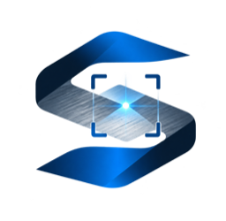

# SurfaceNet

**Real-time surface inspection on Arm64 Android**

A scratch and a reflection can look alike in a single camera frame. SurfaceNet uses a mounted phone to localize surface defects, check whether a finding persists under a second exposure, and give the operator a procedure grounded in the captured evidence. Vision, Llama guidance, and inspection records run on the device. [Bharat AI-SoC PS5](https://arm-education.github.io/Arm-Developer-Labs/Bharat_AI_SoC_2026_27.html)

## Source code

| Area | Where to start |
| --- | --- |
| Android app | [Camera, inspection workflow and operator controls](android/app/src/main/java/io/surfaceguard/android/MainActivity.java) · [App source and model assets](android/app/src/main) |
| Vision and evidence checks | [Inspection and clean-reference logic](android/app/src/main/java/io/surfaceguard/android/Inspection.java) · [Second-light registration and mask checks](android/app/src/main/java/io/surfaceguard/android/Lighting.java) |
| Advisory and traceability | [Llama inference](android/app/src/main/java/io/surfaceguard/android/Advice.java) · [Procedure validation](android/app/src/main/java/io/surfaceguard/android/Procedure.java) · [SQLite evidence and CSV export](android/app/src/main/java/io/surfaceguard/android/Trace.java) |
| Training and evaluation | [Model training, quantization, calibration and checks](training) · [Reproduce the experiments](docs/engineering.md#build-and-reproduce) |
| Browser evidence lab | [Client and inference worker](website/dist) · [Run locally](#browser-evidence-lab) |

## Build and reproduce

Use JDK 17, Android SDK Platform 35, Build Tools 35.0.0 and `adb`. The APK supports Arm64 Android 9 and later. Run from the repository root.

```sh
./scripts/fetch-models.sh --runtime-only
./android/gradlew -p android :app:assembleDebug
adb install -r android/app/build/outputs/apk/debug/app-debug.apk
```

The build includes the INT8 vision programs. To enable the Llama advisory, run `./scripts/fetch-models.sh`, copy `models/llama.pte` and `models/tokenizer.model` to the phone, and import both under **Device → Manage model files**. Setup downloads the pinned model and verifies both files. Inference runs offline after import.

To check the full workflow in airplane mode, open **Inspect → Specimens → Annotated defect**, tap **Ask local Llama**, and look for **Llama 3.2 1B · ExecuTorch / XNNPACK** in the response. Enter a part ID, save, then reopen the mask and recommendation in **Trace log**. [Arm64 debug APK](website/dist/assets/surfaceguard.apk) · [Demo steps](JURY.md#live-demo)

## PS5 requirement coverage

| Requirement | SurfaceNet implementation |
| --- | --- |
| Detect defects, cracks and anomalies | CameraX feeds a quantized vision model that produces a pixel mask for learned defects. A clean reference can detect unfamiliar changes in a fixed fixture. |
| Classify type and severity | Mask geometry identifies line-like, compact or diffuse findings and estimates severity. Unknown changes remain unrated. |
| Alert and guide the operator | Temporal evidence drives hold, review, pass or reacquire decisions. On a hold, a rear-light check tests whether the same pixels persist. Llama 3.2 1B Instruct runs through ExecuTorch on the Arm CPU and selects an allowed procedure from the frozen evidence. |
| Log inspections | SQLite stores the part ID, decision, captures, masks and advisory source. CSV export preserves inspection metadata. |
| Run locally | Separate ExecuTorch programs handle INT8 vision and Llama guidance. The app benchmarks both vision profiles and exports live camera timings. |

An inconclusive lighting check keeps the original hold in place. The implementation and calibration thresholds are documented alongside the model exports and benchmark commands. [Engineering and reproducibility](docs/engineering.md)

## Validation

The official KolektorSDD2 test split contains 1,004 images. At each profile’s calibrated operating point, four views referred **35 fewer clean images** for alert or review, a **21.2% reduction**, while both profiles referred **105 of 110 defective images**.

| Measure | Single-view INT8 | Four-view INT8 |
| --- | ---: | ---: |
| Image AUROC | 97.29% | **97.45%** |
| Image average precision | 91.48% | **92.36%** |
| Pixel average precision | **73.45%** | 69.16% |
| Defects sent to alert or review | 105 / 110 | 105 / 110 |
| Clean images sent to alert or review | 165 / 894 | **130 / 894** |
| ExecuTorch vision program | **153.4 KiB** | 159.0 KiB |

Single view is the live default. It had higher pixel average precision and lower warm-forward latency in the Apple M3 benchmark. The offline workflow was verified on an Arm64 Android emulator with Wi-Fi disabled. Sustained camera-to-decision latency and torch repeatability await a controlled physical fixture trial. [Evaluation procedure and trade-offs](docs/engineering.md#validation) · [Held-out score evidence](output/pdf/surfacenet-report/evidence/reflection-edge.json) · [Review thresholds and counts](output/pdf/surfacenet-report/evidence/reflection-review.json)

## Demo and report

- [98-second Android walkthrough](output/walkthrough/SurfaceNet-Android-Walkthrough.mp4) · [Transcript](output/walkthrough/SurfaceNet-Android-Walkthrough-Transcript.md)
- [Technical and venture report (PDF)](output/pdf/SurfaceNet-PS5-Technical-and-Venture-Report.pdf)
- [Jury briefing and live demo procedure](JURY.md)

### Browser evidence lab

Serve the browser client from the repository root and open [localhost:8765](http://127.0.0.1:8765). The lab runs FP32 vision in ONNX Runtime Web, compares exposures on specimen replays and exposes precision–recall plots. Camera access on a phone requires an HTTPS origin.

```sh
python3 -m http.server 8765 --bind 127.0.0.1 --directory website/dist
```

Third-party code, model and specimen attribution is listed in the engineering notes. [Dependencies and attribution](docs/engineering.md#dependencies-and-attribution)
